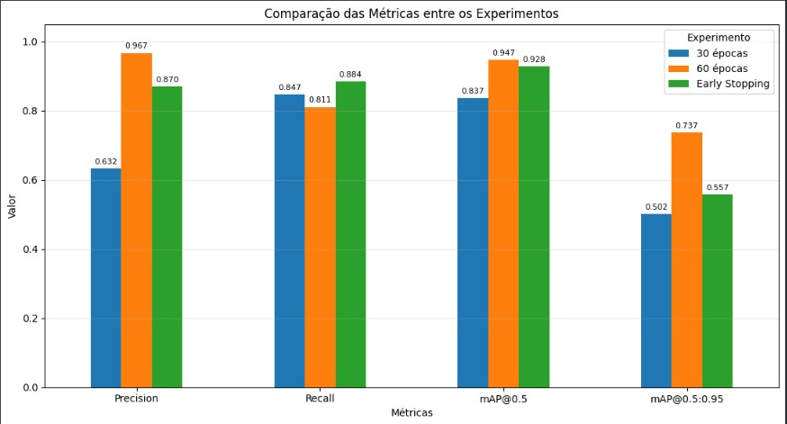
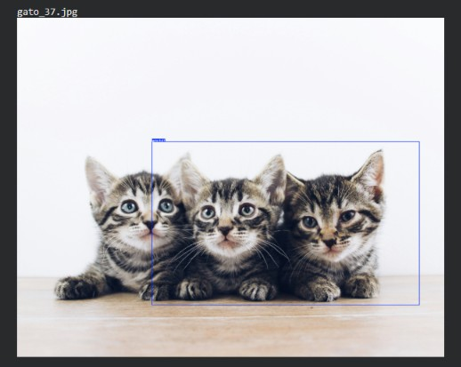
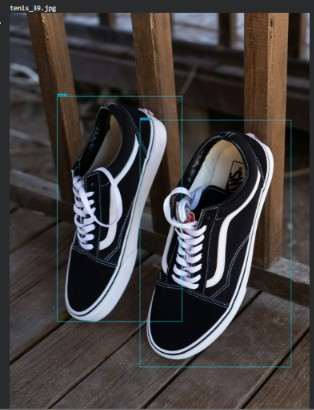

# AI Project Document — Fase 6 — FIAP

## Projeto

FarmTech Solutions — Fase 6 — Visão Computacional e Redes Neurais.

## Integrantes

| Nome | RM |
|---|---|
| Renata de Almeida Marinho | 569342 |
| Pedro Henrique Lacerda | 573114 |
| Giselli Mayumi Takahashi Yokoyama | 572690 |
| João Otavio Moraes | 573227 |
| David Ribeiro Prado de Lacerda | 570350 |

## Professores

- **Tutora da Turma A:** [Nicolly de Souza](https://github.com/nicollycrs).
- **Coordenador:** André Godoi Chiovato.

## Sumário

- [1. Introdução](#c1)
- [2. Visão Geral do Projeto](#c2)
- [3. Desenvolvimento do Projeto](#c3)
- [4. Resultados e Avaliações](#c4)
- [5. Conclusões e Trabalhos Futuros](#c5)
- [6. Referências](#c6)
- [Anexos](#c7)

# 1. Introdução

## 1.1. Escopo do Projeto

### 1.1.1. Contexto da Inteligência Artificial

No cenário proposto pela FIAP, a FarmTech Solutions amplia sua atuação para aplicações de Inteligência Artificial além do agronegócio, incluindo visão computacional. O projeto demonstra a identificação de classes e a localização de objetos em imagens, além de comparar diferentes abordagens de classificação e detecção.

### 1.1.2. Descrição da Solução Desenvolvida

A solução utiliza imagens de gatos e tênis. Na Entrega 1, uma YOLOv5s é adaptada às duas classes por meio de treinamento com imagens rotuladas. Na Entrega 2, o comportamento dessa rede é comparado com a YOLOv5 padrão e uma CNN treinada do zero.

A documentação detalhada, o código e as saídas de execução estão nos [notebooks da Entrega 1](../src/entrega_1/RenataDeAlmeidaMarinho_rm569342_PedroHenriqueLacerda_rm573114_GiselliMayumiTakahashiYokoyama_rm572690_JoaoOtavioMoraes_rm573227_DavidRibeiroPradoDeLacerda_rm570350_pbl_fase6.ipynb) e da [Entrega 2](../src/entrega_2/RenataDeAlmeidaMarinho_rm569342_PedroHenriqueLacerda_rm573114_GiselliMayumiTakahashiYokoyama_rm572690_JoaoOtavioMoraes_rm573227_DavidRibeiroPradoDeLacerda_rm570350_pbl_fase6.ipynb).

# 2. Visão Geral do Projeto

## 2.1. Objetivos do Projeto

- Demonstrar o funcionamento de um detector de objetos customizado.
- Avaliar a influência do número de épocas sobre as métricas de validação.
- Aplicar o detector em imagens separadas para teste e discutir suas limitações.
- Comparar customização, uso de pesos pré-treinados e treinamento de uma CNN do zero.

## 2.2. Público-Alvo

O público-alvo é o cliente fictício da FarmTech Solutions que deseja compreender uma aplicação prática de visão computacional. Os notebooks e o repositório também permitem que a equipe avaliadora da FIAP acompanhe o desenvolvimento e reproduza os experimentos.

## 2.3. Metodologia

O dataset foi organizado em treino, validação e teste, com 40 imagens por classe. Treino e validação possuem rotulações com bounding boxes no formato YOLO. Foram executados três treinamentos customizados, inferências nas imagens de teste, uma avaliação da YOLOv5 padrão e o treinamento de uma CNN para classificação da imagem completa.

A comparação considera métricas apropriadas a cada tarefa, facilidade de uso, custo de treinamento e tempo de inferência. A avaliação da YOLO nas imagens de teste é qualitativa, pois essas imagens não possuem rotulações de referência para cálculo de métricas de detecção.

# 3. Desenvolvimento do Projeto

## 3.1. Tecnologias Utilizadas

Python, Google Colab, GPU Tesla T4 nos experimentos registrados, PyTorch, YOLOv5, TensorFlow/Keras, scikit-learn, Pandas, Matplotlib, Pillow, Make Sense AI, Git e GitHub.

## 3.2. Modelagem e Algoritmos

A YOLOv5s customizada utiliza pesos pré-treinados `yolov5s.pt` como ponto inicial para adaptar a detecção às classes gato e tênis. A YOLOv5 padrão utiliza diretamente seus pesos pré-treinados, sem treinamento adicional com o dataset do projeto.

A CNN utiliza normalização dos pixels, três blocos convolucionais com pooling, uma camada densa, Dropout e saída binária com ativação sigmoid. Seus parâmetros são treinados do zero. A arquitetura completa está registrada no notebook da Entrega 2.

## 3.3. Treinamento e Teste

| Conjunto | Gato | Tênis | Total |
|---|---:|---:|---:|
| Treino | 32 | 32 | 64 |
| Validação | 4 | 4 | 8 |
| Teste | 4 | 4 | 8 |

A YOLOv5 utiliza entrada de 640 pixels e batch size 16. Foram realizados treinamentos de 30 e 60 épocas e um treinamento de até 90 épocas com Early Stopping e paciência de 10. O terceiro foi encerrado após 50 épocas, com melhor resultado registrado no índice de época 39 pelo log.

A CNN utiliza imagens de 224 × 224 pixels, batch size 16, otimizador Adam e binary cross-entropy. Foi configurada para até 50 épocas com Early Stopping monitorando `val_loss`. O treinamento foi encerrado na época 12 e restaurou os pesos da época 7.

Os dados estão disponíveis no arquivo [`dataset.zip`](../dataset.zip), armazenado com Git LFS devido ao tamanho aproximado de 214 MiB. Cada notebook baixa o conteúdo completo desse ZIP do GitHub, verifica seu SHA-256, extrai as imagens e rotulações e prepara `/content/dataset` antes dos experimentos. O uso do GitHub em substituição ao Google Drive foi autorizado para esta entrega.

# 4. Resultados e Avaliações

## 4.1. Análise dos Resultados

### YOLOv5 customizada — validação

| Experimento | Épocas executadas | Precision | Recall | mAP@0.5 | mAP@0.5:0.95 | Treinamento (h) |
|---|---:|---:|---:|---:|---:|---:|
| 30 épocas | 30 | 0,632 | 0,847 | 0,837 | 0,502 | 0,518 |
| 60 épocas | 60 | 0,967 | 0,811 | 0,947 | 0,737 | 1,038 |
| Early Stopping | 50 | 0,870 | 0,884 | 0,928 | 0,557 | 0,931 |

O treinamento de 60 épocas apresentou os maiores valores de Precision e mAP, enquanto o experimento com Early Stopping apresentou o maior Recall. O aumento de épocas favoreceu algumas métricas, mas não todas simultaneamente.

O detector obtido com Early Stopping foi aplicado nas oito imagens de teste. As saídas mostram reconhecimento das duas classes e dificuldades na localização individual de múltiplos objetos, incluindo caixas abrangendo mais de uma instância.

### Comparação das abordagens

| Abordagem | Resultado registrado | Inferência registrada |
|---|---|---|
| YOLOv5 customizada | Precision 0,870, Recall 0,884 e mAP@0.5 0,928 na validação do experimento com Early Stopping | 39,7 ms por imagem |
| YOLOv5 padrão | Classe cat identificada nas quatro imagens de gatos; nenhuma identificação correta de tênis nas quatro imagens dessa classe | 29,4 ms por imagem |
| CNN do zero | Acurácia de teste de 62,5%, com cinco acertos em oito imagens e loss de 0,6326 | 29,48 ms por imagem |

A CNN classificou corretamente as quatro imagens de gatos e uma das quatro imagens de tênis. As curvas de treino e validação apresentaram sinais de overfitting, discutidos no notebook. A soma dos tempos apresentados nos logs das 12 épocas da CNN é de 208 segundos, aproximadamente 3 minutos e 28 segundos. Trata-se de uma estimativa baseada nos tempos arredondados por época; não houve medição independente do tempo total do processo.

A YOLOv5 padrão exige menos preparação por utilizar um modelo pronto. A customização exige rotulagem e treinamento, mas adapta a rede às classes do projeto. A CNN exige definição da arquitetura e treinamento próprio.

As métricas da YOLO avaliam detecção de objetos, enquanto a acurácia da CNN avalia classificação da imagem. Os resultados não são diretamente equivalentes. Os tempos de inferência também foram obtidos por procedimentos distintos e devem ser interpretados com cautela.

## 4.2. Feedback dos Usuários

O projeto utiliza um cliente fictício como contexto de demonstração. Não foi registrada uma avaliação formal com usuários finais. A análise apresentada baseia-se nas saídas dos modelos, nos gráficos e na discussão técnica dos notebooks.

# 5. Conclusões e Trabalhos Futuros

Os experimentos demonstram a aplicação de detecção customizada e classificação de imagens, bem como diferenças práticas entre adaptar uma rede, utilizar pesos prontos e treinar uma CNN do zero.

O dataset reduzido limita a generalização dos resultados. A validação da YOLO contém oito imagens e 14 instâncias, tornando as métricas sensíveis a poucas detecções. A avaliação qualitativa dos testes evidencia dificuldades com múltiplos objetos. A CNN apresenta desempenho desigual entre classes e sinais de overfitting.

Como continuidade, podem ser avaliadas maior quantidade e diversidade de imagens, melhoria das rotulações, mais exemplos com múltiplas instâncias, ajustes de hiperparâmetros e avaliação quantitativa da detecção em um conjunto de teste rotulado.

# 6. Referências

- FIAP. Enunciado da Fase 6 fornecido ao grupo.
- FIAP. MODELO GIT FIAP e AI Project Document, utilizados como referência de organização documental.
- [FarmTech Solutions — Fase 5](https://github.com/david-fiap-ai/farmtech-fase5-cap1), utilizado como referência para a identificação da equipe e dos professores.
- [Ultralytics — repositório YOLOv5](https://github.com/ultralytics/yolov5), utilizado pelos notebooks para obtenção da implementação e das dependências.
- Código, configurações e saídas dos [notebooks do projeto](../src/README.md).

# Anexos

## Comparação dos experimentos

## Exemplos de limitações na detecção

Os demais prints estão na pasta [`assets/prints/entrega_1/`](../assets/prints/entrega_1/). O [vídeo demonstrativo](https://youtu.be/j6Jf3tsRY2E) apresenta a Entrega 1.
