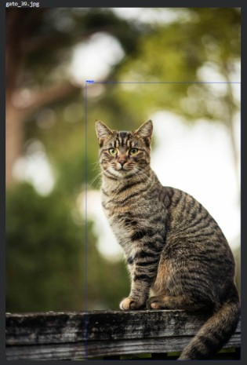
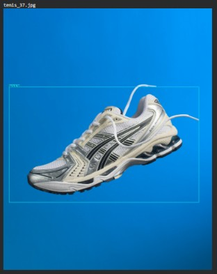

# Entrega 1 — Detecção de Objetos com YOLOv5

Customização da YOLOv5s para detectar **gatos** e **tênis**, utilizando um dataset de 80 imagens. Foram realizados treinamentos com **30 épocas**, **60 épocas** e **Early Stopping**, seguidos da comparação das métricas de validação e da avaliação visual das oito imagens de teste.

[Abrir o notebook completo da Entrega 1](RenataDeAlmeidaMarinho_rm569342_PedroHenriqueLacerda_rm573114_GiselliMayumiTakahashiYokoyama_rm572690_JoaoOtavioMoraes_rm573227_DavidRibeiroPradoDeLacerda_rm570350_pbl_fase6.ipynb)

[Assistir ao vídeo demonstrativo](https://youtu.be/j6Jf3tsRY2E)

As saídas dos treinamentos, as curvas de aprendizado, os resultados de inferência e as conclusões estão no notebook. Os prints complementares estão na pasta [`assets/prints/entrega_1/`](../../assets/prints/entrega_1/).

O notebook baixa automaticamente o `dataset.zip` do repositório, verifica sua integridade, extrai os dados e pode ser executado sozinho em uma nova sessão do Colab.

## Exemplos de teste

| Gato | Tênis |
|---|---|
|  |  |

[Voltar à apresentação do projeto, integrantes, dataset e instruções de execução](../../README.md)
